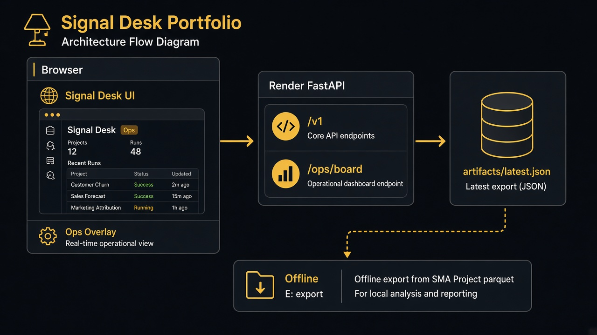
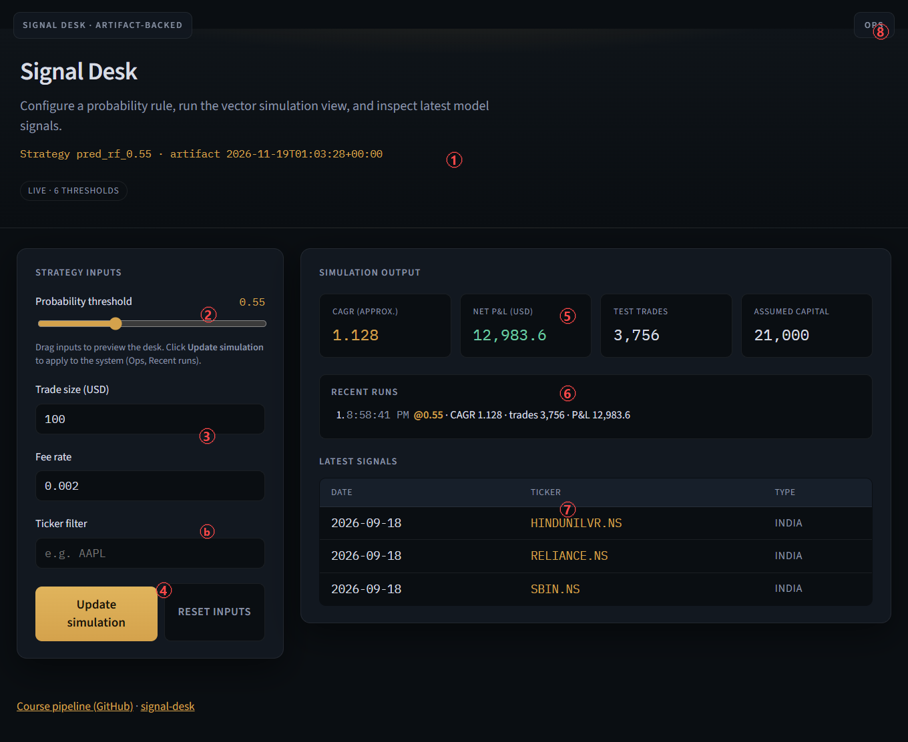
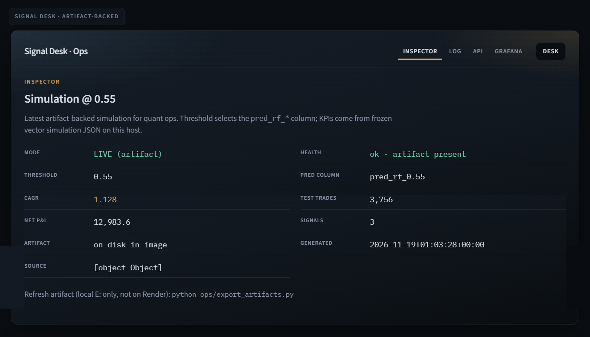
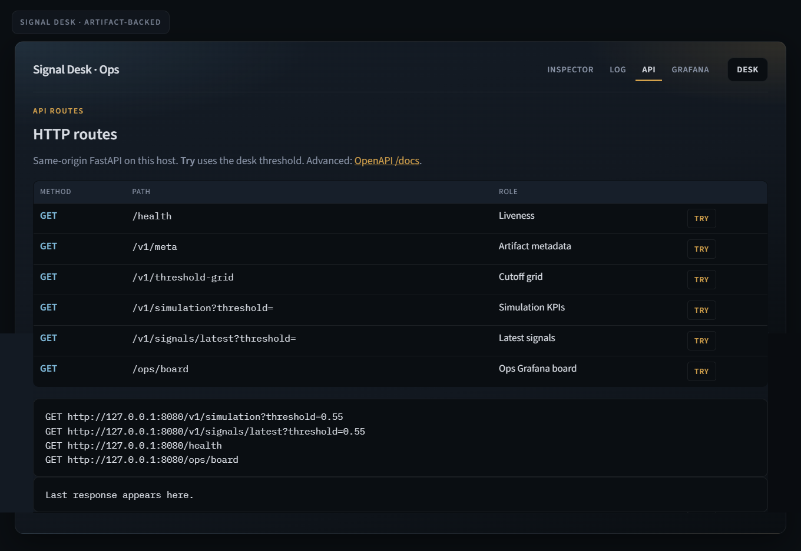
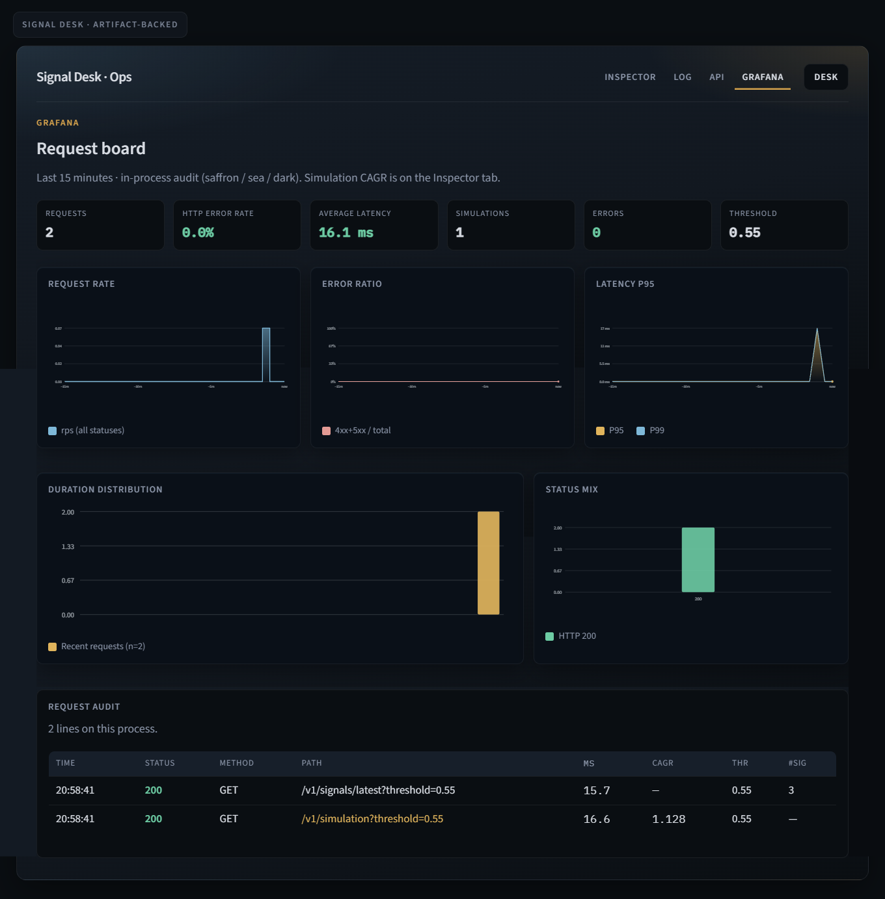

# Signal Desk


## Purpose

**Signal Desk** is a portfolio-facing demo for **US equity machine-learning trade signals**.  
Offline training and parquet live on your workstation; this repository ships only **`artifacts/latest.json`** — frozen simulation KPIs and latest signal rows for a fixed threshold grid (**0.55–0.60**).

The desk lets you **drag strategy inputs** to preview KPIs and the **Latest signals** table on screen. **Update simulation** commits that threshold to the running API, **Recent runs**, and **Ops** (Inspector, session log, route tester, in-app Grafana board). There is no re-fit or parquet access on Render.

| | |
|---|---|
| **Repository** | https://github.com/zakard114/signal-desk |
| **Live demo** | https://signal-desk-c3dx.onrender.com |
| **Course context** | [Stock Markets Analytics Zoomcamp](https://github.com/DataTalksClub/stock-markets-analytics-zoomcamp) — personal study materials @ `dd4cd5a` |

Drag inputs to **preview** the desk (KPIs + Latest signals). **Update simulation** applies to the system (Ops, Recent runs). Red hint under the button: *Update simulation applies changes.*

## Features

- **Web:** threshold slider on the artifact grid, simulation KPIs (preview on drag), latest signals table, client-side ticker filter (table only)
- **API:** `/v1/threshold-grid`, `/v1/simulation?threshold=`, `/v1/signals/latest?threshold=`
- **Ops:** HoldRisk-style overlay — **Inspector · Log · API · Grafana**; server board `GET /ops/board` (audit, rate/latency charts on the same process)

No parquet in this repository; the cloud image serves committed `artifacts/latest.json` only.

## Architecture



**Live path:** Browser (`static/`) → Render FastAPI → read `artifacts/latest.json` · Ops tab → `GET /ops/board` on the same host (no separate Grafana server on Render).

**Request path:** drag threshold → client preview from grid → **Update simulation** → `GET /v1/simulation` + `GET /v1/signals/latest`.

**Offline (E: only):** course parquet → `ops/export_artifacts.py` → refresh `latest.json` before commit.

Full Mermaid and ASCII reference: [docs/ARCHITECTURE.md](docs/ARCHITECTURE.md).

## Screenshots



| # | UI element | What it does |
|---|------------|--------------|
| 1 | Hero + run-meta | Artifact strategy column and generated timestamp |
| 2 | Probability threshold | **0.55–0.60** grid; drag previews KPIs + signals |
| 3 | Notional / fee | Scale preview P&L and capital |
| 3b | Ticker filter | **Latest signals** rows only (no Ops/API change) |
| 4 | Update simulation / Reset | Commits threshold; appends **Recent runs** |
| 5 | Simulation KPIs | Preview while dragging; committed values after Update |
| 6 | Recent runs | Last runs in this browser session (up to 8) |
| 7 | Latest signals | Signal rows for the active threshold |
| 8 | Ops | Inspector · Log · API · Grafana in the same window |

### Ops overlay

| Inspector | Log | API | Grafana tab |
|:---:|:---:|:---:|:---:|
|  |  |  |  |

More captures and re-annotate notes: [docs/PREVIEW.md](docs/PREVIEW.md).

## Quick demo

**Example:** open the [live demo](https://signal-desk-c3dx.onrender.com), drag threshold **0.55 → 0.60** (watch **Test trades** and signal row count), click **Update simulation**, then open **Ops → Grafana**. Step-by-step: [Demo walkthrough](docs/DEMO_WALKTHROUGH.md).

## Local

```powershell
. E:\IT_SPACES\AI\scripts\use_e_drive.ps1
cd E:\IT_SPACES\AI\Projects\sma\us-equity-signals
E:\IT_SPACES\AI\ZoomCamp\ML\.venv\Scripts\pip.exe install -r requirements.txt
# refresh artifact (needs course parquet on E:)
E:\IT_SPACES\AI\ZoomCamp\ML\.venv\Scripts\python.exe ops\export_artifacts.py
E:\IT_SPACES\AI\ZoomCamp\ML\.venv\Scripts\uvicorn.exe app.main:app --port 8080
```

http://127.0.0.1:8080/

## Deploy (Render)

1. Connect this GitHub repo (`main` push → Docker rebuild on Render).
2. **Web Service** → Environment **Docker** → `Dockerfile` at repo root.
3. Health check: `/health`.
4. Image includes `artifacts/latest.json`.

`render.yaml` included for Blueprint deploy (service name `signal-desk`).

## Docs

| Doc | Purpose |
|-----|---------|
| [docs/README.md](docs/README.md) | Documentation index |
| [ARCHITECTURE.md](docs/ARCHITECTURE.md) | Mermaid + live/offline paths |
| [OPS.md](docs/OPS.md) | Ops overlay and `GET /ops/board` |
| [DEMO_WALKTHROUGH.md](docs/DEMO_WALKTHROUGH.md) | Which inputs change what |
| [DEPLOY_RENDER.md](docs/DEPLOY_RENDER.md) | Render Blueprint / manual Docker |
| [PREVIEW.md](docs/PREVIEW.md) | Screenshot pack (numbered desk, Ops) |
| [TROUBLESHOOTING.md](docs/TROUBLESHOOTING.md) | Mock vs live, slider, Render |
| [NOTES.md](docs/NOTES.md) | Artifact model and scaling |
| [LIP_LINKEDIN.md](docs/LIP_LINKEDIN.md) | Learning in Public drafts |

## Credits

- Curriculum and simulation methodology: [Stock Markets Analytics Zoomcamp](https://github.com/DataTalksClub/stock-markets-analytics-zoomcamp) (Modules 02–04).
- Combined parquet (YFinance, TA features, FRED macro) is built locally per course materials—not stored here. To re-export artifacts, use `ops/export_artifacts.py` against your local parquet tree.

## Layout

```
app/           FastAPI
static/        UI
ops/           export_artifacts.py, screenshot helpers
artifacts/     latest.json
docs/          architecture, ops, images
```