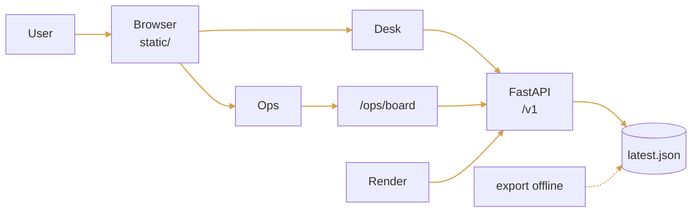

# Signal Desk


**US equity ML signals — FastAPI + ledger UI over frozen simulation artifacts.**

Built as a portfolio demo alongside [Stock Markets Analytics Zoomcamp](https://github.com/DataTalksClub/stock-markets-analytics-zoomcamp) (personal study materials @ `dd4cd5a`).

**Live demo (Render):** https://signal-desk-c3dx.onrender.com  
**OpenAPI:** https://signal-desk-c3dx.onrender.com/docs  
**Repository:** https://github.com/zakard114/signal-desk  

Desk + **Ops** (Inspector · Log · API · in-app Grafana tab) on one host. No separate Grafana server on Render.

## Mission

**Signal Desk — show the signal, commit on purpose.**

Reviewers need to see how a **probability threshold** changes trades, P&L, and latest model signals **without** re-running training in the cloud. This app reads a **frozen artifact** (`artifacts/latest.json`) and exposes:

- A **desk** where dragging inputs **previews** KPIs and the signals table.
- **Update simulation** to commit the threshold to the API, **Recent runs**, and **Ops** audit charts.
- Same-origin **Ops** for inspection, session log, route **Try**, and `GET /ops/board`.

Parquet, RandomForest fit, and `export_artifacts.py` stay **offline**; Render ships the JSON snapshot in the Docker image only.

## Table of contents

- [Mission](#mission)
- [Problem](#problem)
- [Status](#status)
- [Paths (read this first)](#paths-read-this-first)
- [Recent updates](#recent-updates)
- [Quick demo](#quick-demo)
- [Features](#features)
- [Quick start](#quick-start)
- [Architecture](#architecture)
- [Decisions and trade-offs](#decisions-and-trade-offs)
- [Project structure](#project-structure)
- [Screenshots](#screenshots)
- [Evaluation criteria](#evaluation-criteria)
- [Cloud deployment](#cloud-deployment)
- [Documentation](#documentation)
- [Troubleshooting](#troubleshooting)
- [License](#license)

---

## Problem

Course simulations produce rich KPI grids and signal lists, but sharing them usually means notebooks or static CSVs. Support and portfolio reviewers need:

1. A **live URL** with consistent numbers (not a re-fit on every click).
2. A **clear UX** between *trying* a threshold (preview) and *recording* it (Update + Ops).
3. **Operator visibility** — last simulation, API trace, and request-rate charts without a second Grafana deployment.

Signal Desk answers (1)–(3) from one committed artifact and one FastAPI process.

[↑ Contents](#table-of-contents)

---

## Status

**Portfolio-ready** — desk preview on drag, Update commit, six-point threshold grid (**0.55–0.60**), Ops overlay with in-app Grafana board.

**Public deploy:** `main` push → Docker rebuild on [Render](https://signal-desk-c3dx.onrender.com) ([`docs/DEPLOY_RENDER.md`](docs/DEPLOY_RENDER.md), [`render.yaml`](render.yaml)). Artifact refresh is **local export → commit → push → deploy** (not on Render).

[↑ Contents](#table-of-contents)

---

## Paths (read this first)

Commands below assume you are in the **repository root** after cloning.

| | |
|--|--|
| **Your machine** | Whatever path you cloned into, e.g. `~/signal-desk` |
| **Example used in this README** | `E:\IT_SPACES\AI\Projects\sma\us-equity-signals` (author’s Windows layout — **not required**) |

Replace the example `cd …` with your own clone path. Relative paths like `app/`, `artifacts/`, and `ops/` are the same everywhere.

[↑ Contents](#table-of-contents)

---

## Recent updates

**2026-11 — desk preview vs system commit**

- Dragging threshold, notional, or fee **previews** KPIs and **Latest signals** from `GET /v1/threshold-grid` (including per-cutoff `latest_signals` when the artifact includes them).
- **Update simulation** is the only path that hits simulation API for history, refreshes Inspector, and drives **Ops → Grafana** from live audit rows.
- Red hint under the button when controls diverge from the last commit: *Update simulation applies changes.*

[↑ Contents](#table-of-contents)

---

## Quick demo

**Example:** open the [live demo](https://signal-desk-c3dx.onrender.com), drag threshold **0.55 → 0.60** (watch **Test trades** and signal row count), click **Update simulation**, then open **Ops → Grafana**.

Step-by-step scripts: [`docs/DEMO_WALKTHROUGH.md`](docs/DEMO_WALKTHROUGH.md).

[↑ Contents](#table-of-contents)

---

## Features

- **Web:** threshold slider on the artifact grid, simulation KPIs (preview on drag), latest signals table, client-side ticker filter (**Latest signals** only)
- **API:** `/v1/threshold-grid`, `/v1/simulation?threshold=`, `/v1/signals/latest?threshold=`, `/health`, `/v1/meta`
- **Ops:** HoldRisk-style overlay — **Inspector · Log · API · Grafana**; server board `GET /ops/board` (audit, rate/latency charts on the same process)

No parquet in this repository; the cloud image serves committed `artifacts/latest.json` only.

[↑ Contents](#table-of-contents)

---

## Quick start

**Recommended:** run locally against the committed artifact (no export required for a first look).

```powershell
# Example path (replace with your clone root):
cd E:\IT_SPACES\AI\Projects\sma\us-equity-signals
. E:\IT_SPACES\AI\scripts\use_e_drive.ps1   # optional: author Windows cache on E:
pip install -r requirements.txt             # or use your venv
uvicorn app.main:app --port 8080
```

Open http://127.0.0.1:8080/ — badge should show live API when `/v1/meta` loads.

**Refresh artifact** (needs course parquet on your machine — not on Render):

```powershell
# After use_e_drive.ps1 and local parquet paths configured:
python ops\export_artifacts.py
# Commit artifacts/latest.json, push, redeploy Render if you want cloud to match.
```

`scripts/use_e_drive.ps1` is optional (author keeps caches on `E:`). Skip it if you use default cache locations.

[↑ Contents](#table-of-contents)

---

## Architecture


**Live path (infographic):** User → Render FastAPI → `static/` desk + Ops overlay → `GET /v1/*` and `GET /ops/board` → read `artifacts/latest.json` baked into the image. No separate Grafana server on Render.

**Request path (short):** drag threshold → client preview from grid → **Update simulation** → `GET /v1/simulation` + `GET /v1/signals/latest` · Ops **Grafana** tab polls `GET /ops/board` on the same process.

Technical graph (compact — left-to-right):



Step-by-step Mermaid (TD) and ASCII: [`docs/ARCHITECTURE.md`](docs/ARCHITECTURE.md).

[↑ Contents](#table-of-contents)

---

## Decisions and trade-offs

- **Frozen artifact vs live training on Render:** cloud stays fast and cheap; numbers age until you re-export and redeploy. Trade-off: no “train once per visitor.”
- **Preview on drag vs Update commit:** avoids flooding audit logs and makes Ops meaningful only after an explicit commit. Trade-off: users must click Update to refresh Grafana simulation counters.
- **In-app Grafana tab vs hosted Grafana:** one Docker service, HoldRisk-style board from in-process audit. Trade-off: not a full Grafana deployment with external datasources.
- **Six-point threshold grid only:** slider snaps to nearest artifact row; between-grid drags look flat until the nearest cutoff changes. Trade-off: simpler demo — use **0.55 vs 0.60** for obvious deltas.
- **Ticker filter client-side:** filters **Latest signals** only; KPIs and Ops unchanged. Trade-off: filter does not call the API.

[↑ Contents](#table-of-contents)

---

## Project structure

```text
app/                 # FastAPI, audit middleware, /ops/board
static/              # Desk + Ops UI (index.html, app.js, app.css)
ops/                 # export_artifacts.py, screenshot helpers
artifacts/           # latest.json (committed; baked into Docker)
docs/                # Architecture, Ops, walkthrough, images/
Dockerfile           # Render image
render.yaml          # Blueprint (service signal-desk)
```

[↑ Contents](#table-of-contents)

---

## Screenshots

### Desk (numbered callouts)

Live desk on Render — drag preview, **Update simulation**, Recent runs, Latest signals.  
https://signal-desk-c3dx.onrender.com


| # | UI element | What it does |
|---|------------|--------------|
| 1 | Hero + run-meta | Artifact strategy column and generated timestamp |
| 2 | Probability threshold | **0.55–0.60** grid; drag previews KPIs + signals |
| 3 | Notional / fee | Scale preview P&L and capital |
| 3b | Ticker filter | **Latest signals** rows only (no Ops/API change) |
| 4 | Update simulation / Reset | Commits threshold; appends **Recent runs** |
| 5 | Simulation KPIs | Preview while dragging; committed values after Update |
| 6 | Recent runs | Last runs in this browser session (up to 8) |
| 7 | Latest signals | Signal rows for the active threshold |
| 8 | Ops | Inspector · Log · API · Grafana in the same window |

Plain capture: [`docs/images/desk/desk-after-update.png`](docs/images/desk/desk-after-update.png). Extended gallery: [`docs/PREVIEW.md`](docs/PREVIEW.md).

### Ops overlay (Inspector · Log · API · Grafana)

**Inspector** — last simulation snapshot, artifact meta, CAGR.


**Log** — API calls from this browser session.


**API** — routes, **Try**, sample responses ([OpenAPI `/docs`](https://signal-desk-c3dx.onrender.com/docs)).


**Grafana tab** — in-process board from `GET /ops/board` (not a separate Grafana server on Render).


[↑ Contents](#table-of-contents)

---

## Evaluation criteria

Maps the **course capstone** and **this repo** to the official [Stock Markets Analytics Zoomcamp project rubric](https://github.com/DataTalksClub/stock-markets-analytics-zoomcamp/blob/main/projects/README.md) (maximum **36** points; **minimum 6** from the **bold** checkboxes in sections 1–6). Peer reviewers use the course form — **do not inflate scores** here; follow the **Evidence** links.

| Submitted to course form | Role |
|--------------------------|------|
| [ZoomCamp `SMA/Project`](https://github.com/zakard114/ZoomCamp/tree/main/SMA/Project) @ [`dd4cd5a`](https://github.com/zakard114/ZoomCamp/commit/dd4cd5a) | **Graded pipeline** — data → features → RandomForest → vector simulation → `run.py` / `project.ipynb` |
| **This repo** (`signal-desk`) + https://signal-desk-c3dx.onrender.com | **LiP / portfolio** — frozen artifact API, desk UI, Ops monitoring, Render deploy |

| # | Rubric block (official) | Max | Claimed | Evidence |
|---|-------------------------|-----|---------|----------|
| 1 | **Problem description** | 4 | 2 | [`SMA/Project` problem](https://github.com/zakard114/ZoomCamp/tree/main/SMA/Project#problem); [Mission](#mission) + [Problem](#problem) on this README |
| 2 | **Data sources** | 4 | 1 | [Lecture sources](https://github.com/zakard114/ZoomCamp/tree/main/SMA/Project#data-sources-lecture) (YFinance / TA / FRED parquet — local, not on GitHub) |
| 3 | **Data transformations + EDA** | 3 | 1 | [`FEATURE_SETS`](https://github.com/zakard114/ZoomCamp/blob/main/SMA/Project/src/features.py) in `src/features.py` |
| 4 | **Modeling** | 5 | 1 | [`RandomForestClassifier`](https://github.com/zakard114/ZoomCamp/tree/main/SMA/Project#model--strategy), `pred_rf_0.55` |
| 5 | **Trading simulation** | 8 | 1 | Vector sim + fees + CAGR in `src/simulation.py`; [verified run](https://github.com/zakard114/ZoomCamp/tree/main/SMA/Project#verified-run-local-2026-11-18); six cutoffs → [`artifacts/latest.json`](artifacts/latest.json) via `ops/export_artifacts.py` |
| 6 | **Automation** | 5 | 2 | [`run.py`](https://github.com/zakard114/ZoomCamp/tree/main/SMA/Project#reproduce) + `project.ipynb`, `requirements.txt`; this repo: [Quick start](#quick-start), [`Dockerfile`](Dockerfile), `ops/export_artifacts.py` |
| 7 | **Bonus** | 7 | 3 | Container ([`Dockerfile`](Dockerfile)), cloud ([Cloud deployment](#cloud-deployment)), monitoring ([Ops → Grafana](#ops-overlay-inspector--log--api--grafana), [`docs/OPS.md`](docs/OPS.md)). Peer discretionary (+1–2) not self-scored. |
| | **Total (self-assessment)** | **36** | **11** | Official rubric caps at 36; course requires **≥6** from **bold** rows in sections 1–6 (bold items evidenced in `SMA/Project` @ `dd4cd5a` — run `run.py`). |

**Claimed** = author self-score against the [official checklist](https://github.com/DataTalksClub/stock-markets-analytics-zoomcamp/blob/main/projects/README.md) only where evidence is linked; peers and the course form decide the final score. Optional rubric rows (second strategy, cron, benchmark, …) are **not** counted in **Claimed** until documented.

### Quick verification commands

```powershell
# Capstone pipeline (replace clone path):
cd E:\IT_SPACES\AI\ZoomCamp\SMA\Project
E:\IT_SPACES\AI\ZoomCamp\ML\.venv\Scripts\python.exe run.py

# This repo — API + artifact:
cd E:\IT_SPACES\AI\Projects\sma\us-equity-signals
uvicorn app.main:app --port 8080
# Smoke: GET http://127.0.0.1:8080/v1/threshold-grid  →  "count": 6
```

[↑ Contents](#table-of-contents)

---

## Cloud deployment

**Official public face:** Render web service `signal-desk` ([`render.yaml`](render.yaml)).

1. Connect GitHub repo `zakard114/signal-desk`, branch `main`.
2. **Web Service** → Environment **Docker** → `Dockerfile` at repo root.
3. Health check: `/health` (expect `artifact_exists: true`).
4. **`main` push** triggers rebuild; wait until **Live**, then hard-refresh the desk if static assets look stale.

Smoke after deploy:

- `GET /v1/threshold-grid` → `"count": 6`
- Desk **Update simulation** twice (e.g. 0.55 and 0.60) → **Ops → Grafana** shows non-zero Simulations

Detail: [`docs/DEPLOY_RENDER.md`](docs/DEPLOY_RENDER.md).

[↑ Contents](#table-of-contents)

---

## Documentation

| Doc | Purpose |
|-----|---------|
| [`docs/README.md`](docs/README.md) | Documentation index |
| [`docs/ARCHITECTURE.md`](docs/ARCHITECTURE.md) | Extended architecture |
| [`docs/OPS.md`](docs/OPS.md) | Ops overlay and `GET /ops/board` |
| [`docs/DEMO_WALKTHROUGH.md`](docs/DEMO_WALKTHROUGH.md) | Which inputs change what |
| [`docs/DEPLOY_RENDER.md`](docs/DEPLOY_RENDER.md) | Render Blueprint / manual Docker |
| [`docs/PREVIEW.md`](docs/PREVIEW.md) | Screenshot pack + annotate script |
| [`docs/TROUBLESHOOTING.md`](docs/TROUBLESHOOTING.md) | Full symptom → fix checklist |
| [`docs/NOTES.md`](docs/NOTES.md) | Artifact model and scaling |
| [`docs/LIP_LINKEDIN.md`](docs/LIP_LINKEDIN.md) | Learning in Public drafts |

[↑ Contents](#table-of-contents)

---

## Troubleshooting

If the desk shows **UI preview (mock)**, KPIs never move on drag, or Ops Grafana stays at zero:

1. **Cold start on Render** — wait 30–60s, reload. Check `GET /health` → `artifact_exists: true`.
2. **Mock badge** — API did not load `/v1/meta` or `/v1/threshold-grid`. Fix: confirm deploy finished; artifact present in image (`503` if missing).
3. **Slider “does nothing”** — you may be between grid points (artifact is **0.55–0.60** only). Jump **0.55 vs 0.60**; watch **Test trades** and signal row count, not CAGR alone.
4. **Ops Grafana empty** — run **Update simulation** on the desk at least twice, then open **Ops → Grafana** (poll ~4s).
5. **Stale cloud numbers** — re-run `ops/export_artifacts.py` locally, commit `artifacts/latest.json`, push, **Manual Deploy** on Render.

Full symptoms, causes, and fixes: [`docs/TROUBLESHOOTING.md`](docs/TROUBLESHOOTING.md).

[↑ Contents](#table-of-contents)

---

## License

- **Code:** [MIT](LICENSE)
- **Artifacts:** `artifacts/latest.json` contains exported simulation KPIs and signal rows from the author’s local training run — not live market data and not investment advice.
- **Course materials:** Methodology follows [Stock Markets Analytics Zoomcamp](https://github.com/DataTalksClub/stock-markets-analytics-zoomcamp) (Modules 02–04). Combined parquet is built locally per course instructions and is **not** redistributed in this repository.

[↑ Contents](#table-of-contents)