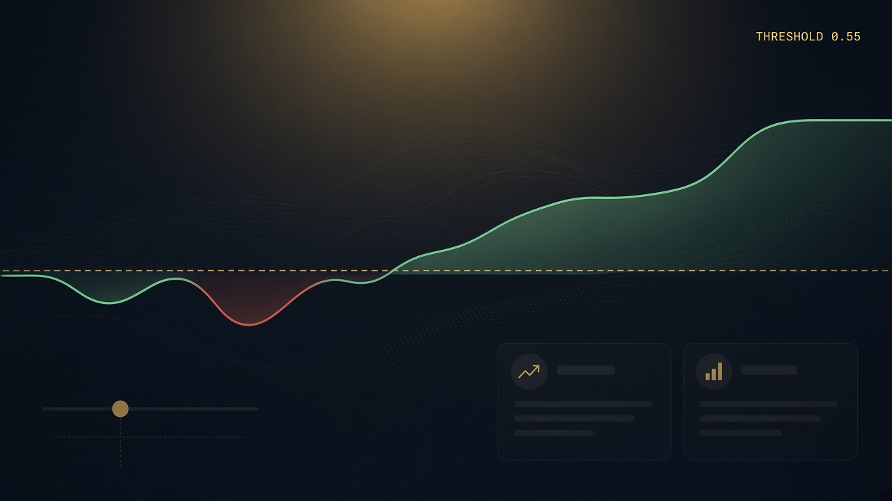

# Signal Desk



US equity ML signals — FastAPI + ledger UI over frozen simulation artifacts.

| | |
|---|---|
| **Repository** | https://github.com/zakard114/signal-desk |
| **Live demo** | https://signal-desk-c3dx.onrender.com |
| **Capstone pipeline** | [ZoomCamp `SMA/Project`](https://github.com/zakard114/ZoomCamp/tree/main/SMA/Project) (course @ `dd4cd5a`) |
| **Try inputs** | [Demo walkthrough](docs/DEMO_WALKTHROUGH.md) (threshold 0.55 vs 0.60, notional, Ops) |

Drag inputs to **preview** the desk (KPIs + Latest signals). **Update simulation** applies to the system (Ops, Recent runs).

## Features

- Web: threshold slider (**0.55–0.60** grid), simulation KPIs (preview on drag), latest signals table
- API: `/v1/threshold-grid`, `/v1/simulation?threshold=`, `/v1/signals/latest?threshold=`
- Ops: HoldRisk-style overlay — **Inspector · Log · API · Grafana**; server board `GET /ops/board` (audit, rate/latency charts)

No parquet in this repository; cloud serves `artifacts/latest.json` only.

## Architecture

See [Architecture](docs/ARCHITECTURE.md) (infographic + Mermaid). **Request path:** threshold → **Update simulation** → `GET /v1/simulation` + signals; Ops Grafana tab → `GET /ops/board` on the same host (no separate Grafana server on Render).

## Screenshots

Numbered desk callouts and Ops captures: [docs/PREVIEW.md](docs/PREVIEW.md).

## Local

```powershell
. E:\IT_SPACES\AI\scripts\use_e_drive.ps1
cd E:\IT_SPACES\AI\Projects\sma\us-equity-signals
E:\IT_SPACES\AI\ZoomCamp\ML\.venv\Scripts\pip.exe install -r requirements.txt
# refresh artifact (needs course parquet on E:)
E:\IT_SPACES\AI\ZoomCamp\ML\.venv\Scripts\python.exe ops\export_artifacts.py
E:\IT_SPACES\AI\ZoomCamp\ML\.venv\Scripts\uvicorn.exe app.main:app --port 8080
```

http://127.0.0.1:8080/

## Deploy (Render)

1. Connect this GitHub repo
2. **Web Service** → Environment **Docker** → `Dockerfile` at repo root
3. Health check: `/health`
4. Commit includes `artifacts/latest.json`

`render.yaml` included for Blueprint deploy (service name `signal-desk`).

## Docs

- [Documentation index](docs/README.md)
- [Architecture](docs/ARCHITECTURE.md)
- [Ops & Grafana](docs/OPS.md)
- [Demo walkthrough](docs/DEMO_WALKTHROUGH.md)
- [Deploy on Render](docs/DEPLOY_RENDER.md)
- [Learning in Public (LinkedIn)](docs/LIP_LINKEDIN.md)
- [Troubleshooting](docs/TROUBLESHOOTING.md)
- [Notes](docs/NOTES.md)
- [README preview pack](docs/PREVIEW.md) — hero, annotated UI, Ops shots

## Credits

- Pipeline and simulation follow [Stock Markets Analytics Zoomcamp](https://github.com/DataTalksClub/stock-markets-analytics-zoomcamp) (Modules 02–04).
- Train/reproduce: [ZoomCamp `SMA/Project`](https://github.com/zakard114/ZoomCamp/tree/main/SMA/Project).
- Combined parquet (YFinance, TA features, FRED macro) is built locally per course materials—not stored here.

## Layout

```
app/           FastAPI
static/        UI
ops/           export_artifacts.py
artifacts/     latest.json
docs/
```