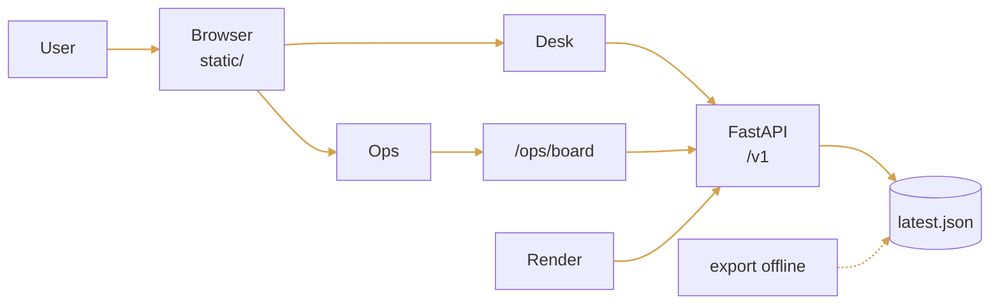
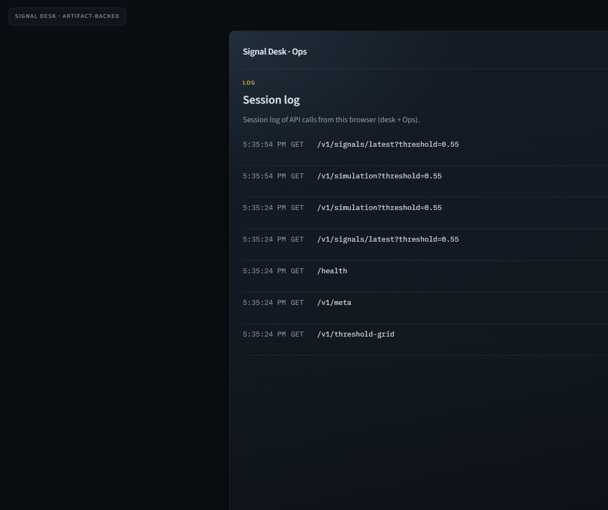

# Signal Desk


**US equity ML signals — FastAPI + ledger UI over frozen simulation artifacts.**

**Capstone (Stock Markets Analytics Zoomcamp):** live desk in this repo + offline ML in [`pipeline/`](pipeline/) — see [`docs/PIPELINE.md`](docs/PIPELINE.md).

**Live demo (Render):** https://signal-desk-c3dx.onrender.com  
**OpenAPI:** https://signal-desk-c3dx.onrender.com/docs  

## For reviewers (start here)

1. **Live app:** https://signal-desk-c3dx.onrender.com  
2. **ML pipeline (local):** [`docs/PIPELINE.md`](docs/PIPELINE.md) → [`pipeline/run.py`](pipeline/run.py)  
3. **App only (no training):** [Quick start](#quick-start) below  
4. **Training data:** [Data (reproduction)](#data-reproduction) — sources, build, apply path (parquet not in Git)  

Desk + **Ops** (Inspector · Log · API · in-app Grafana tab) on one host. No separate Grafana server on Render.

## Mission

**Signal Desk — show the signal, commit on purpose.**

Reviewers need to see how a **probability threshold** changes trades, P&L, and latest model signals **without** re-running training in the cloud. This app reads a **frozen artifact** (`artifacts/latest.json`) and exposes:

- A **desk** where dragging inputs **previews** KPIs and the signals table.
- **Update simulation** to commit the threshold to the API, **Recent runs**, and **Ops** audit charts.
- Same-origin **Ops** for inspection, session log, route **Try**, and `GET /ops/board`.

Parquet, RandomForest fit, and `export_artifacts.py` stay **offline**; Render ships the JSON snapshot in the Docker image only.

## Table of contents

- [For reviewers (start here)](#for-reviewers-start-here)
- [Mission](#mission)
- [Problem](#problem)
- [Data (reproduction)](#data-reproduction)
- [Status](#status)
- [Quick demo](#quick-demo)
- [Features](#features)
- [Quick start](#quick-start)
- [Architecture](#architecture)
- [Project structure](#project-structure)
- [Screenshots](#screenshots)
- [Deploy, docs & troubleshooting](#deploy-docs--troubleshooting)
- [License](#license)

---

## Problem

The capstone **backtest pipeline** (`pipeline/run.py`) produces rich KPI grids and signal lists, but sharing results often stops at notebooks or static exports. Anyone reviewing the project (peers, course graders) needs:

1. A **live URL** with stable numbers (no re-training on each visit).
2. A **clear UX** between *previewing* a threshold (drag) and *recording* it (**Update simulation** + Ops).
3. **Inspectable ops** — simulation history, API trace, and simple charts on the same host (`GET /ops/board`).

Signal Desk covers (1)–(3) with one committed `artifacts/latest.json` and one FastAPI process.

[↑ Contents](#table-of-contents)

---

## Data (reproduction)

Per [course project rules](https://github.com/DataTalksClub/stock-markets-analytics-zoomcamp/blob/main/projects/README.md), **data files are not on GitHub**. Build the combined panel locally (SMA Modules 02–04):

| Source | Role |
|--------|------|
| **YFinance** | Prices, volume, corporate actions |
| **Lecture TA / pattern columns** | Technical features in the combined parquet |
| **FRED** | Macro (e.g. `FEDFUNDS`, yields, CPI) |

**Apply:** point `SMA_DATA_PATH` at your `stocks_df_combined_*.parquet.brotli`, then run `pipeline/run.py` and optionally `ops/export_artifacts.py` to refresh desk JSON. Step-by-step commands and path override: [`docs/PIPELINE.md`](docs/PIPELINE.md) and [`pipeline/README.md`](pipeline/README.md).

**This repo for grading:** clone → Quick start runs the **app** from committed JSON; full ML reproduction is optional but documented above.

[↑ Contents](#table-of-contents)

---

## Status

**Portfolio-ready** — desk preview on drag, Update commit, six-point threshold grid (**0.55–0.60**), Ops overlay with in-app Grafana board.

**Public deploy:** `main` push → Docker rebuild on [Render](https://signal-desk-c3dx.onrender.com) ([`docs/DEPLOY_RENDER.md`](docs/DEPLOY_RENDER.md), [`render.yaml`](render.yaml)). Artifact refresh is **local export → commit → push → deploy** (not on Render).

[↑ Contents](#table-of-contents)

---

## Quick demo

**Example:** open the [live demo](https://signal-desk-c3dx.onrender.com), drag threshold **0.55 → 0.60** (watch **Test trades** and signal row count), click **Update simulation**, then open **Ops → Grafana**.

Step-by-step scripts: [`docs/DEMO_WALKTHROUGH.md`](docs/DEMO_WALKTHROUGH.md).

[↑ Contents](#table-of-contents)

---

## Features

- **Web:** threshold slider on the artifact grid, simulation KPIs (preview on drag), latest signals table, client-side ticker filter (**Latest signals** only)
- **API:** `/v1/threshold-grid`, `/v1/simulation?threshold=`, `/v1/signals/latest?threshold=`, `/health`, `/v1/meta`
- **Ops:** in-browser overlay — **Inspector · Log · API · Grafana** tab; `GET /ops/board` (audit + rate/latency charts in-process)

The cloud image serves committed `artifacts/latest.json` only (see [Data (reproduction)](#data-reproduction) for training data).

[↑ Contents](#table-of-contents)

---

## Quick start

**Recommended:** run locally against the committed artifact (no export required for a first look). Use **your clone root** for `cd` ([paths note](docs/NOTES.md#paths-and-clone-roots)).

```powershell
cd <your-clone-root>   # repository root after git clone
python -m venv .venv
.venv\Scripts\activate          # Linux/macOS: source .venv/bin/activate
pip install -r requirements.txt
uvicorn app.main:app --host 127.0.0.1 --port 8080
```

Open http://127.0.0.1:8080/ — badge should show live API when `/v1/meta` loads.

**Refresh artifact** (needs course parquet on your machine — not on Render; see [`docs/PIPELINE.md`](docs/PIPELINE.md)):

```powershell
python ops\export_artifacts.py
# Commit artifacts/latest.json, push, redeploy Render if you want cloud to match.
```

Optional Windows cache paths: [`docs/NOTES.md#paths-and-clone-roots`](docs/NOTES.md#paths-and-clone-roots).

[↑ Contents](#table-of-contents)

---

## Architecture


**Live path (infographic):** User → Render FastAPI → `static/` desk + Ops overlay → `GET /v1/*` and `GET /ops/board` → read `artifacts/latest.json` baked into the image. No separate Grafana server on Render.

**Request path (short):** drag threshold → client preview from grid → **Update simulation** → `GET /v1/simulation` + `GET /v1/signals/latest` · Ops **Grafana** tab polls `GET /ops/board` on the same process.

Technical graph (compact — left-to-right):



Step-by-step Mermaid (TD) and ASCII: [`docs/ARCHITECTURE.md`](docs/ARCHITECTURE.md).

[↑ Contents](#table-of-contents)

---

## Project structure

```text
app/                 # FastAPI, audit middleware, /ops/board
static/              # Desk + Ops UI (index.html, app.js, app.css)
ops/                 # export_artifacts.py, screenshot helpers
pipeline/            # Capstone ML: run.py, src/, FINDINGS, analysis_snapshot
artifacts/           # latest.json (committed; baked into Docker)
docs/                # Architecture, Ops, PIPELINE, walkthrough, images/
Dockerfile           # Render image
render.yaml          # Blueprint (service signal-desk)
```

[↑ Contents](#table-of-contents)

---

## Screenshots

### Desk (numbered callouts)

Live desk on Render — drag preview, **Update simulation**, Recent runs, Latest signals.  
https://signal-desk-c3dx.onrender.com


| # | UI element | What it does |
|---|------------|--------------|
| 1 | Hero + run-meta | Artifact strategy column and generated timestamp |
| 2 | Probability threshold | **0.55–0.60** grid; drag previews KPIs + signals |
| 3 | Notional / fee | Scale preview P&L and capital |
| 3b | Ticker filter | **Latest signals** rows only (no Ops/API change) |
| 4 | Update simulation / Reset | Commits threshold; appends **Recent runs** |
| 5 | Simulation KPIs | Preview while dragging; committed values after Update |
| 6 | Recent runs | Last runs in this browser session (up to 8) |
| 7 | Latest signals | Signal rows for the active threshold |
| 8 | Ops | Inspector · Log · API · Grafana in the same window |

Plain capture: [`docs/images/desk/desk-after-update.png`](docs/images/desk/desk-after-update.png). Extended gallery: [`docs/PREVIEW.md`](docs/PREVIEW.md).

### Ops overlay (Inspector · Log · API · Grafana)

| Inspector | Log | API | Grafana tab |
|:---:|:---:|:---:|:---:|
|  |  |  |  |

[↑ Contents](#table-of-contents)

---

## Deploy, docs & troubleshooting

**Render:** public service [`signal-desk`](https://signal-desk-c3dx.onrender.com) — [`render.yaml`](render.yaml), Dockerfile, health `/health`, GitHub `main` auto-deploy.

| Topic | Doc |
|-------|-----|
| Deploy steps, smoke tests, artifact refresh | [`docs/DEPLOY_RENDER.md`](docs/DEPLOY_RENDER.md) |
| ML pipeline, parquet path, `run.py` | [`docs/PIPELINE.md`](docs/PIPELINE.md) |
| Doc index | [`docs/README.md`](docs/README.md) |
| Mock badge, slider grid, Ops Grafana, stale KPIs | [`docs/TROUBLESHOOTING.md`](docs/TROUBLESHOOTING.md) |

[↑ Contents](#table-of-contents)

---

## License

- **Code:** [MIT](LICENSE)
- **Artifacts:** `artifacts/latest.json` contains exported simulation KPIs and signal rows from the author’s local training run — not live market data and not investment advice.
- **Course materials:** Methodology follows [Stock Markets Analytics Zoomcamp](https://github.com/DataTalksClub/stock-markets-analytics-zoomcamp) (Modules 02–04). Combined parquet is built locally per course instructions and is **not** redistributed in this repository.

[↑ Contents](#table-of-contents)