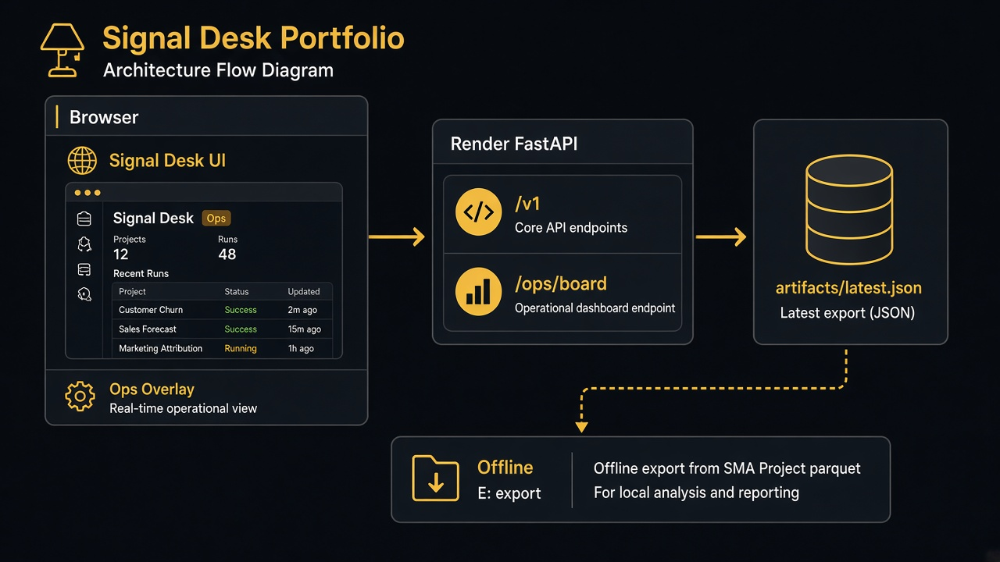
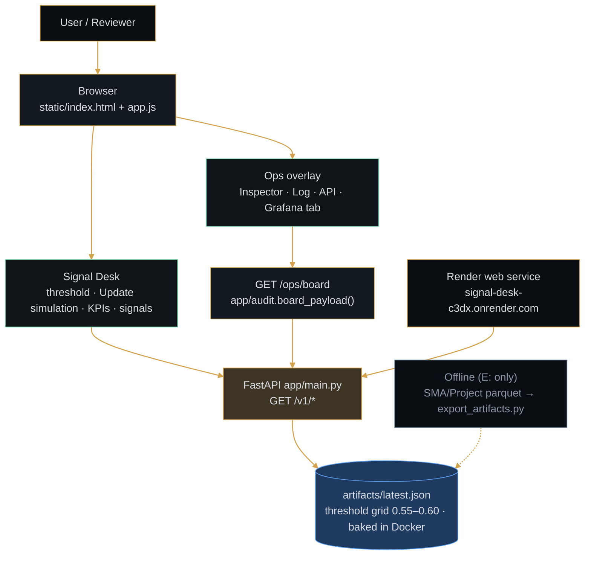

# Architecture

Summary infographic and request path also appear on the [repository README](../README.md#architecture).



**Live path:** Browser (`static/`) → Render FastAPI → `artifacts/latest.json` · Ops → `GET /ops/board` on the same process.  
**Offline (E: only):** ZoomCamp [`SMA/Project`](https://github.com/zakard114/ZoomCamp/tree/main/SMA/Project) parquet → `ops/export_artifacts.py` → `latest.json`.

**Not in cloud:** parquet, training, re-fit on each request.



## ASCII (quick reference)

```text
Browser → FastAPI → artifacts/latest.json
Desk: /v1/simulation, /v1/signals/latest
Ops: /ops/board (in-app Grafana tab)
```

Full screenshots and numbered desk callouts: [PREVIEW.md](PREVIEW.md).