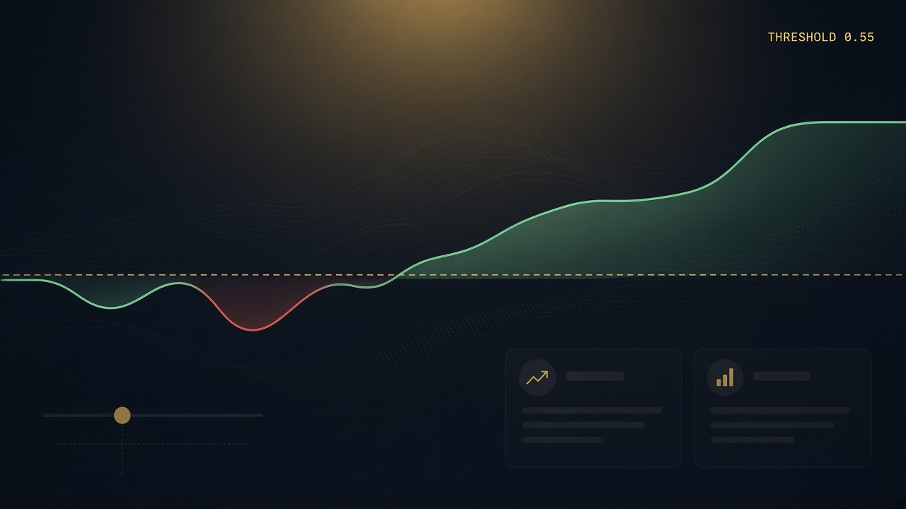
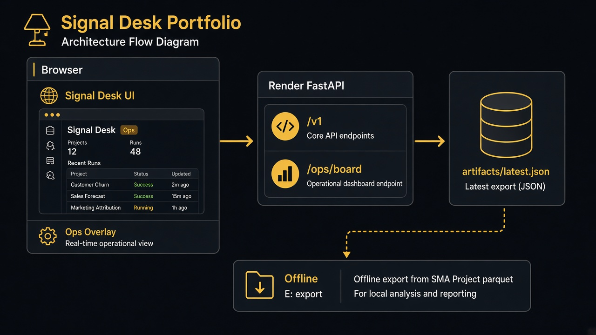
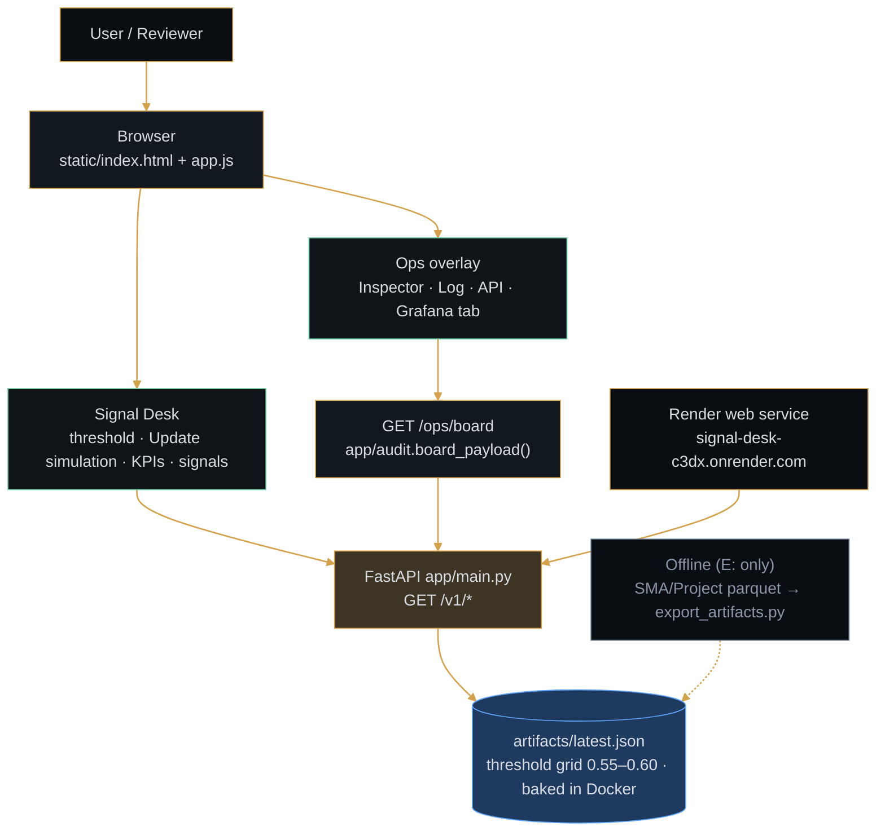
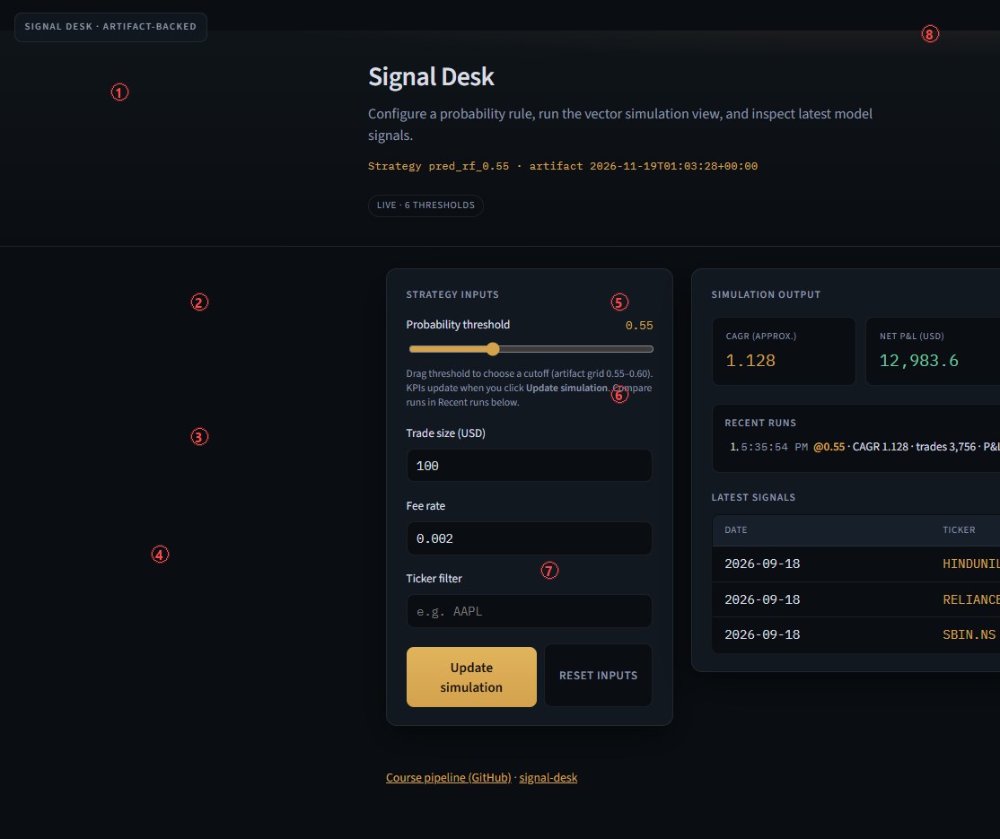
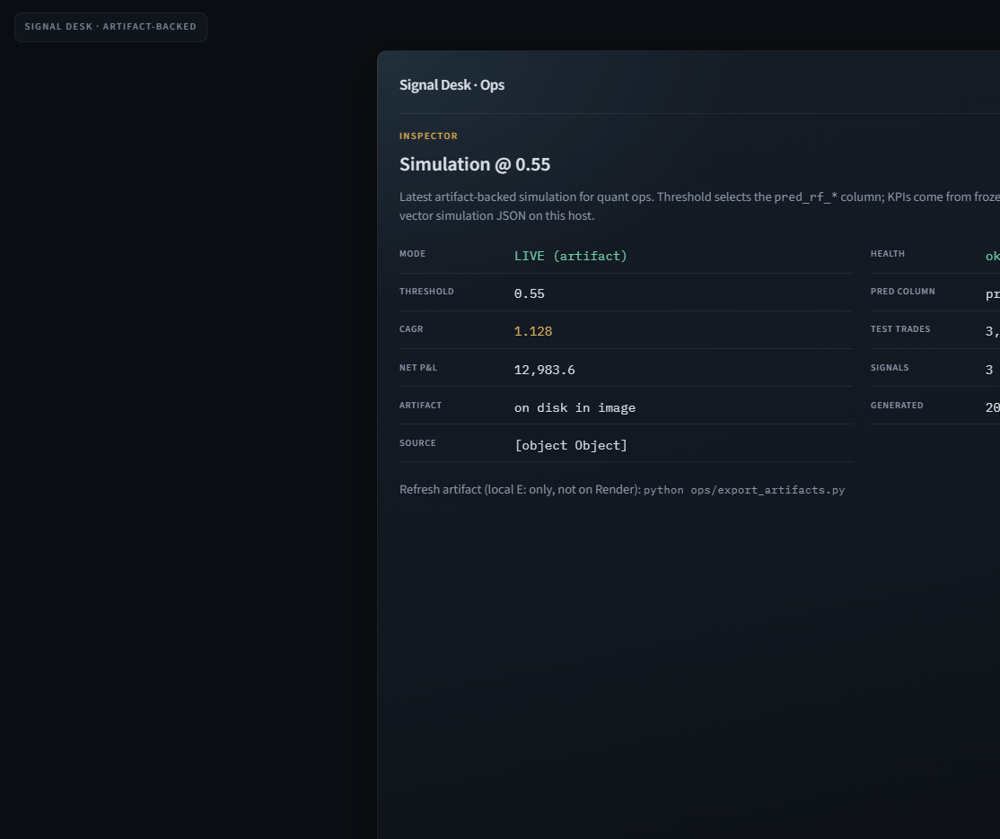
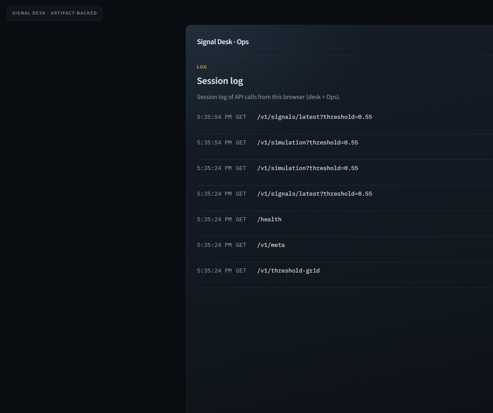
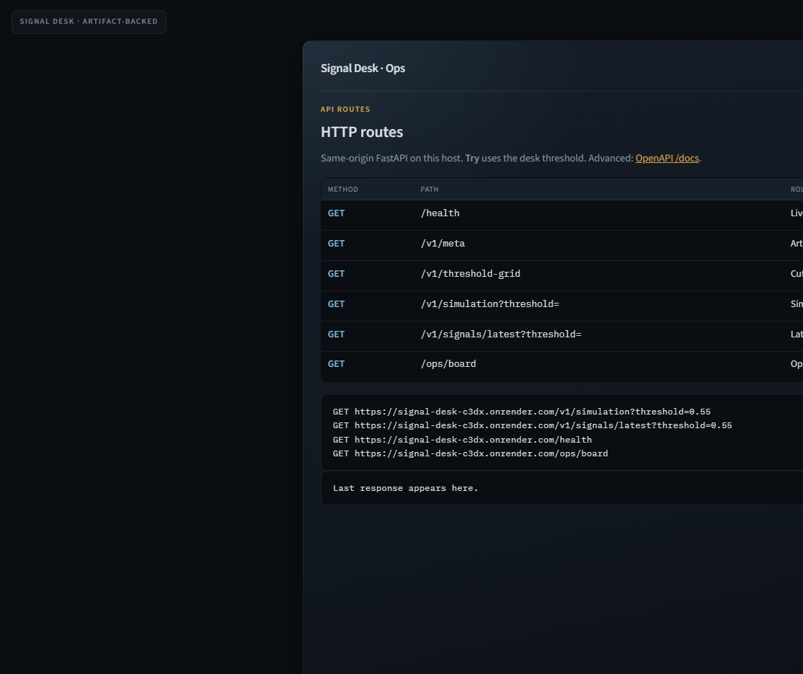
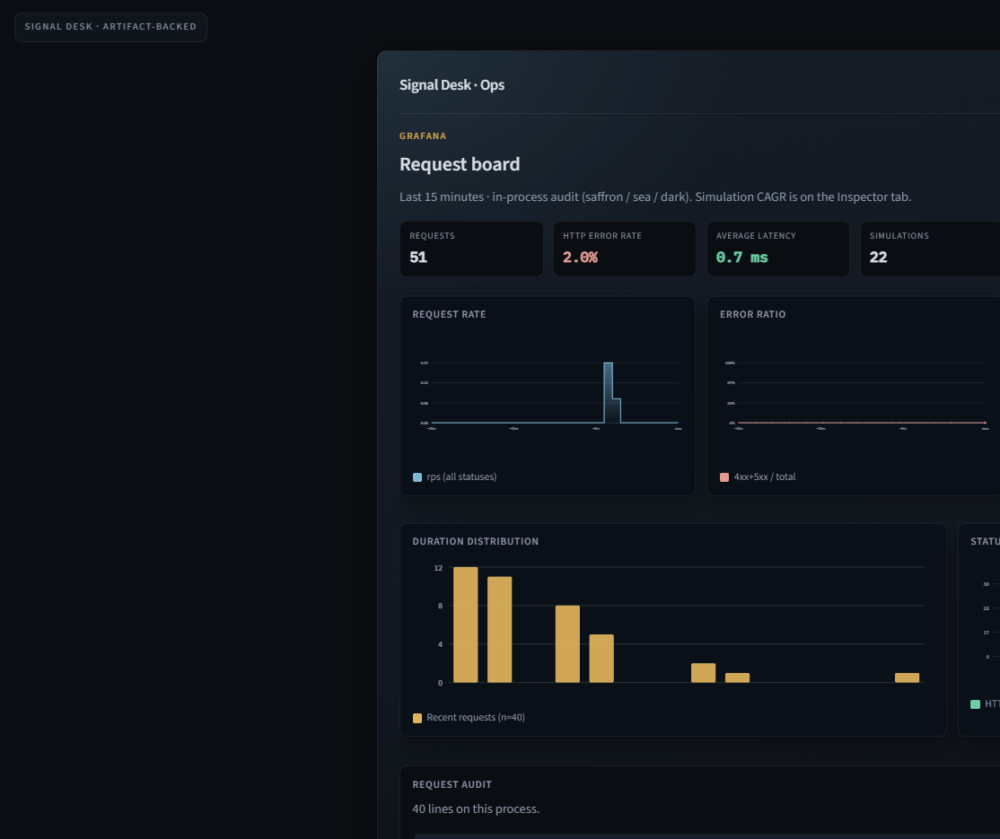

# Signal Desk — documentation preview (draft)

**Status:** Screenshot + architecture pack; hero and summary merged into root `README.md`.  
**Captured from:** https://signal-desk-c3dx.onrender.com/?v=20261119-deskux (2026-11-19).

---

## Hero (official — chart illustration)

Root [README](../README.md) uses this still only. UI appears in **Screenshots** below.



Optional alternate crop (not in README): `readme-hero-desk-crop.png` via `ops/crop_desk_hero.py`.

---

## Architecture (policy-refund style)



**Live path (short):** Browser (`static/`) → Render FastAPI → read `artifacts/latest.json` · Ops tab → `GET /ops/board` on the same process.  
**Offline (E: only):** ZoomCamp `SMA/Project` parquet → `ops/export_artifacts.py` → `latest.json`.

Technical graph (same system, code-oriented):



**Request path (short):** drag threshold → client preview from grid → **Update simulation** → `GET /v1/simulation` + `GET /v1/signals/latest`. Ops **Grafana** tab → in-process audit (`/ops/board`), not a separate Grafana server on Render.

---

## Screenshots — how to read the desk

Dragging previews the **desk** (KPIs + Latest signals). **Update simulation** applies to the **system** (Ops, Recent runs). Red hint under the button: *Update simulation applies changes.*

### Desk (numbered)



| # | UI element | What it does |
|---|------------|--------------|
| 1 | Hero + run-meta | Shows artifact strategy column and generated timestamp |
| 2 | Probability threshold | **0.55–0.60** grid; drag previews KPIs + signals |
| 3 | Notional / fee | Scale preview P&L and capital |
| 3b | Ticker filter | Filters **Latest signals** rows only (no Ops API) |
| 4 | Update simulation / Reset | Runs API for the selected threshold; appends **Recent runs** |
| 5 | Simulation KPIs | Preview while dragging; **committed** values after Update (Net P&L colour) |
| 6 | Recent runs | Last runs in this browser session (up to 8) |
| 7 | Latest signals | Latest signal rows for the active threshold |
| 8 | Ops | Opens Inspector · Log · API · Grafana in the same window |

Plain capture (no numbers): [desk-after-update.png](./images/desk/desk-after-update.png)

Callouts: **thin red neon ring (1px)**, **red digit**, centred with `anchor="mm"` — no fill, no white double stroke.

Re-annotate after layout changes:

```powershell
. E:\IT_SPACES\AI\scripts\use_e_drive.ps1
cd E:\IT_SPACES\AI\Projects\sma\us-equity-signals
E:\IT_SPACES\AI\ZoomCamp\ML\.venv\Scripts\python.exe ops\annotate_desk_preview.py
```

### Ops tabs

| Tab | Preview | Role |
|-----|---------|------|
| Inspector |  | Last simulation snapshot, CAGR, pred column, artifact info |
| Log |  | API calls from this browser (desk + Ops) |
| API |  | Routes, **Try**, sample URL and last response |
| Grafana |  | In-app board from `GET /ops/board` (no external Grafana on Render) |

---

## Next step

Fold this content into root `README.md` (hero, Architecture, Screenshots sections) and link from [docs/README.md](./README.md). Replace `.jpg` hero/infographic with refined exports if you redraw in Figma.